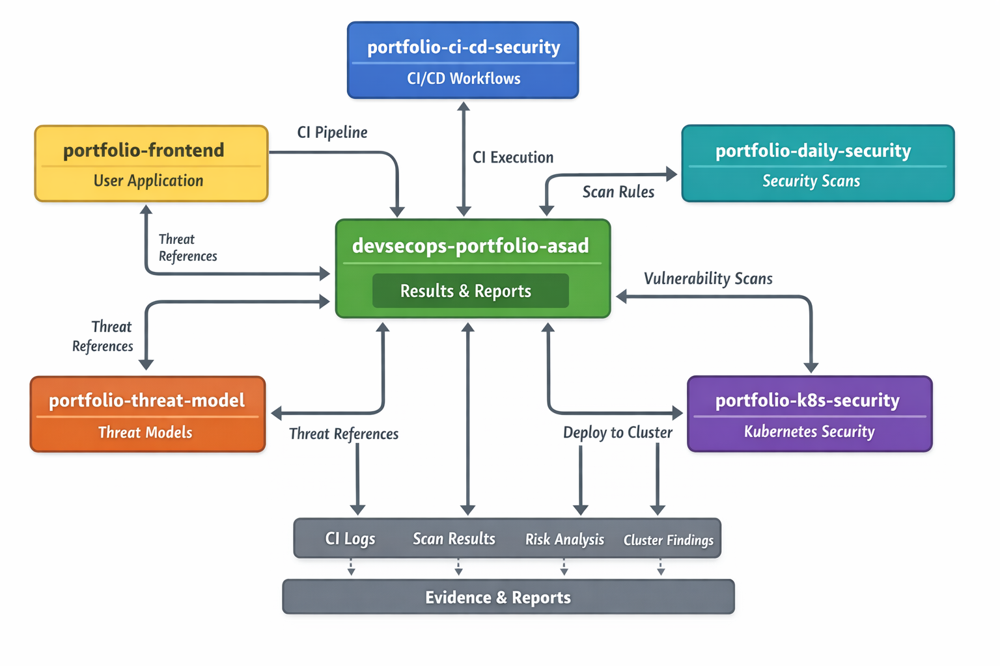

# DevSecOps Portfolio

Welcome to my DevSecOps Portfolio. This repository is the entry point to the DevSecOps portfolio.
It links all projects that together demonstrate end to end security
across build, deploy, runtime, and governance.

## Table of Contents

### DevSecOps Portfolio Index

This portfolio is designed as a system, not
standalone projects. Each repository has a single responsibility and
produces evidence consumed by others.

[Frontend Application](https://github.com/asadyare/portfolio-frontend)

Cloudflare Pages:
User facing application deployed with secure CI pipelines and protected by
downstream controls.

[Shared CI and Security Workflows](https://github.com/asadyare/portfolio-ci-cd-security)

Centralised CI
security workflows for secret scanning, dependency checks, container scanning, and policy validation used by all repositories.

[Daily Security Automation](https://github.com/asadyare/portfolio-daily-security)

Scheduled security
scans, alerting, and weekly reporting for post merge and post deploy
risk.

[Kubernetes Security](https://github.com/asadyare/portfolio-k8s-security)

Cluster security, workload hardening, network isolation, and runtime detection.

[Threat Modeling and Risk Register](https://github.com/asadyare/portfolio-threat-model)

Threat analysis, risk register, and control to evidence mapping.

Security Lifecycle Coverage Plan Threat modeling and risk analysis

Build CI security scanning and policy enforcement

Deploy Kubernetes admission, networking, and TLS controls

Run Runtime detection with Falco

Monitor Metrics, logs, alerts, and reports

Evidence CI logs Security alerts Weekly reports Runtime events

### Architecture

Printable architecture pack documents CI, Kubernetes, runtime detection, and observability.

[DevSecOps Architecture pack](diagrams/DevSecOps_Architecture_Pack.pdf)

### Security Model Summary

- CI prevents insecure changes.
- Kubernetes enforces least privilege.
- Runtime detection catches active threats.
- Reporting provides governance and evidence.

This index represents the full security lifecycle.

Each project is linked to its own repository with detailed instructions on how to set it up and use it. Feel free to explore and reach out if you have any questions or suggestions.

## Contact

You can contact me via [walasaqo@gmail.com](mailto:walasaqo@gmail.com) or connect with me on [LinkedIn](https://www.linkedin.com/in/asad-hassan-20b540313/).

## License

This portfolio is licensed under the MIT License - see the [LICENSE](LICENSE) file for details.
