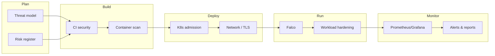
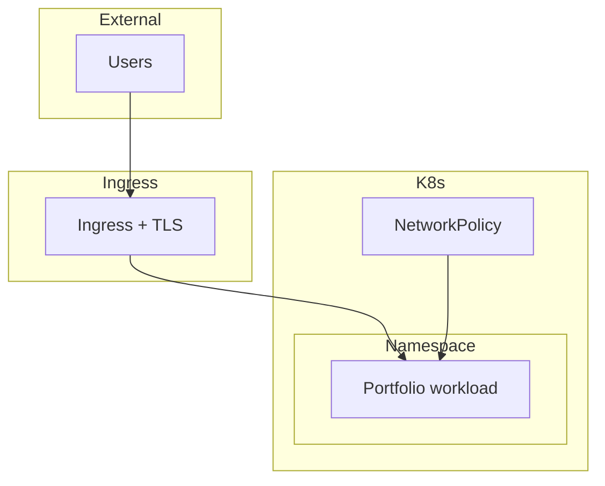
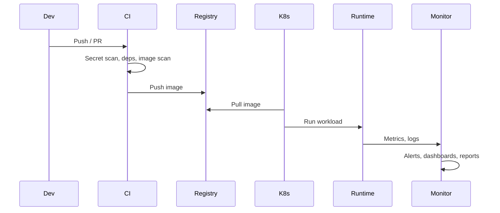

# DevSecOps Architecture Pack

**Portfolio architecture: CI, Kubernetes, runtime detection, and observability**

---

## 1. Overview

This pack documents the security architecture of the DevSecOps portfolio: how build-time, deploy-time, and runtime controls work together to deliver secure, automated releases with evidence for governance.

### Design principles

| Principle | Implementation |
|-----------|----------------|
| **Shift left** | Security checks in CI (SAST, dependency scan, secrets, container scan) before merge. |
| **Policy as code** | Conventions and gates defined in config (e.g. Trivy, Gitleaks, OPA-style checks). |
| **Least privilege** | Non-root containers, read-only filesystems, restricted Kubernetes capabilities and network. |
| **Zero trust** | TLS for ingress, network policies, runtime detection for unexpected behaviour. |
| **Observability** | Metrics, logs, and alerts to detect drift and incidents. |

### Security lifecycle

---

## 2. CI/CD and build-time security

Security is enforced in the pipeline before code is merged or deployed.

### Pipeline stages

1. **Secret scanning** – Gitleaks (or equivalent) to block commits with hardcoded secrets.
2. **Dependency scanning** – npm audit / Trivy for known vulnerabilities in dependencies.
3. **Static analysis** – Linting and optional SAST for code quality and security patterns.
4. **Container image build** – Dockerfile from a trusted base (e.g. nginx-unprivileged).
5. **Container image scan** – Trivy (or similar) on the built image; fail on HIGH/CRITICAL.
6. **Policy checks** – Optional Conftest/OPA for config and manifest validation.

### Tooling

| Concern | Tool | Purpose |
|---------|------|---------|
| Secrets | Gitleaks | Detect secrets in repo and history |
| Dependencies | npm audit, Trivy | CVEs in npm and OS packages |
| Container | Trivy | Image vulnerabilities and misconfig |
| Config | (Optional) Conftest / OPA | Policy on YAML/JSON |

### Evidence

- CI workflow logs and job status.
- Scan reports (e.g. Trivy JSON) stored as artifacts or in security dashboards.
- Badges and status on repositories (e.g. GitHub Actions badges).

**Reference:** [portfolio-ci-cd-security](https://github.com/asadyare/portfolio-ci-cd-security)

---

## 3. Kubernetes security

Deploy-time and cluster controls enforce how workloads run and communicate.

### Admission and workload hardening

- **Non-root containers** – Images run as a defined non-root user (e.g. nginx 101).
- **Read-only root filesystem** – Where possible, `readOnlyRootFilesystem: true`.
- **Resource limits** – CPU/memory requests and limits on all workloads.
- **Image provenance** – Pull from a known registry (e.g. GHCR) with `imagePullSecrets`.

### Network and TLS

- **Ingress with TLS** – Cert-manager (e.g. Let’s Encrypt) for HTTPS.
- **Network policies** – Restrict pod-to-pod and ingress/egress where applicable.
- **Service mesh (optional)** – For mTLS and advanced traffic policy if adopted later.

### Diagram (high level)

**Reference:** [portfolio-k8s-security](https://github.com/asadyare/portfolio-k8s-security)

---

## 4. Runtime detection

Runtime security focuses on detecting unexpected behaviour in production.

### Falco

- **Role** – Rule-based detection of suspicious syscalls and behaviour (e.g. shell in container, sensitive file access).
- **Deployment** – DaemonSet or sidecar; rules supplied via ConfigMap.
- **Output** – Alerts to stdout, files, or downstream (e.g. SIEM, Slack).

### Example rule areas

- Shell spawned in container.
- Write to sensitive paths (e.g. `/etc`).
- Unexpected network or privilege escalation.

**Reference:** Falco rules and deployment in [portfolio-k8s-security](https://github.com/asadyare/portfolio-k8s-security) (e.g. `k8s/` and Falco config).

---

## 5. Observability

Observability supports detection, response, and governance.

### Metrics and dashboards

- **Prometheus** – Scrape metrics from workloads and ingress.
- **Grafana** – Dashboards for availability, latency, and security-related metrics (e.g. scan results, deployment status).
- **ServiceMonitor (optional)** – Prometheus Operator CRDs for scrape config when the operator is installed.

### Logs and tracing

- **Application logs** – Stdout/stderr; optionally aggregated (e.g. Loki, cloud logging).
- **Tracing (optional)** – OpenTelemetry / Grafana Faro for frontend or backend traces.

### Alerting and reporting

- **Alerts** – Prometheus Alertmanager (or equivalent) for SLO and security-related conditions.
- **Scheduled reports** – Daily or weekly security summaries (e.g. dependency drift, open issues) from [portfolio-daily-security](https://github.com/asadyare/portfolio-daily-security).

**Reference:** Observability manifests and docs in [portfolio-k8s-security](https://github.com/asadyare/portfolio-k8s-security) (e.g. `k8s/observability/`).

---

## 6. End-to-end flow

---

## 7. Portfolio repository map

| Repo | Responsibility |
|------|----------------|
| [portfolio-frontend](https://github.com/asadyare/portfolio-frontend) | Frontend app; Cloudflare Pages; consumes shared CI |
| [portfolio-ci-cd-security](https://github.com/asadyare/portfolio-ci-cd-security) | Shared CI security workflows (Trivy, Gitleaks, etc.) |
| [portfolio-daily-security](https://github.com/asadyare/portfolio-daily-security) | Scheduled scans, alerting, weekly reports |
| [portfolio-k8s-security](https://github.com/asadyare/portfolio-k8s-security) | K8s manifests, Falco, observability, Dockerfile |
| [portfolio-threat-model](https://github.com/asadyare/portfolio-threat-model) | Threat model, risk register, control mapping |
| [devsecops-portfolio-asad](https://github.com/asadyare/devsecops-portfolio-asad) | This index and architecture pack |

---

## 8. Best practices summary

- **Automate** – All security checks in CI; no manual gates for standard flows.
- **Fail closed** – Block merge or deploy on critical findings unless explicitly waived with evidence.
- **Document** – Threat model and risk register linked to controls and evidence (CI logs, alerts, reports).
- **Harden defaults** – Non-root, read-only FS, resource limits, network policy where feasible.
- **Observe** – Metrics and logs for availability and security; regular review of alerts and reports.

---

*DevSecOps Architecture Pack — CI, Kubernetes, runtime detection, and observability.*
